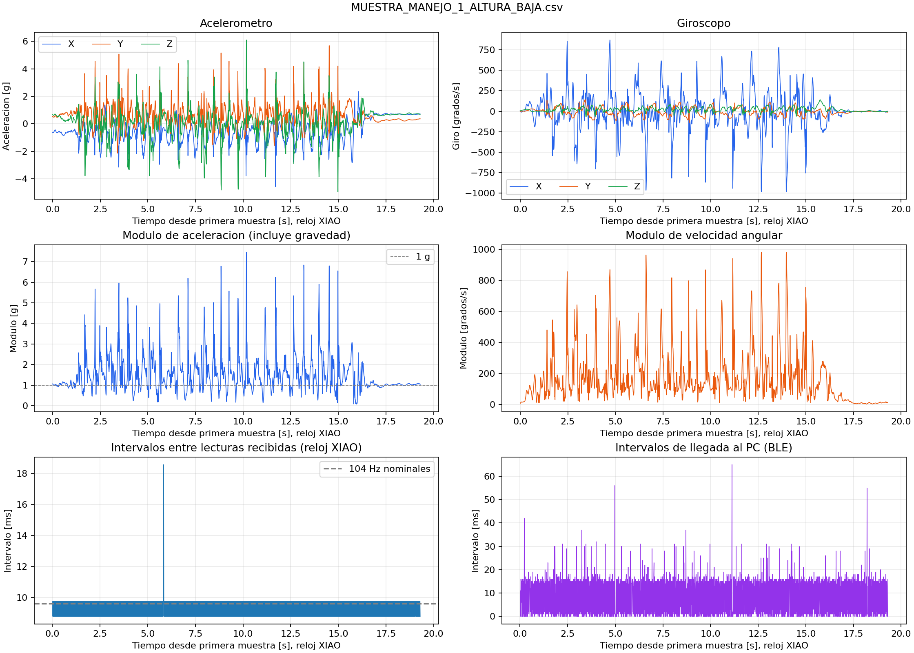
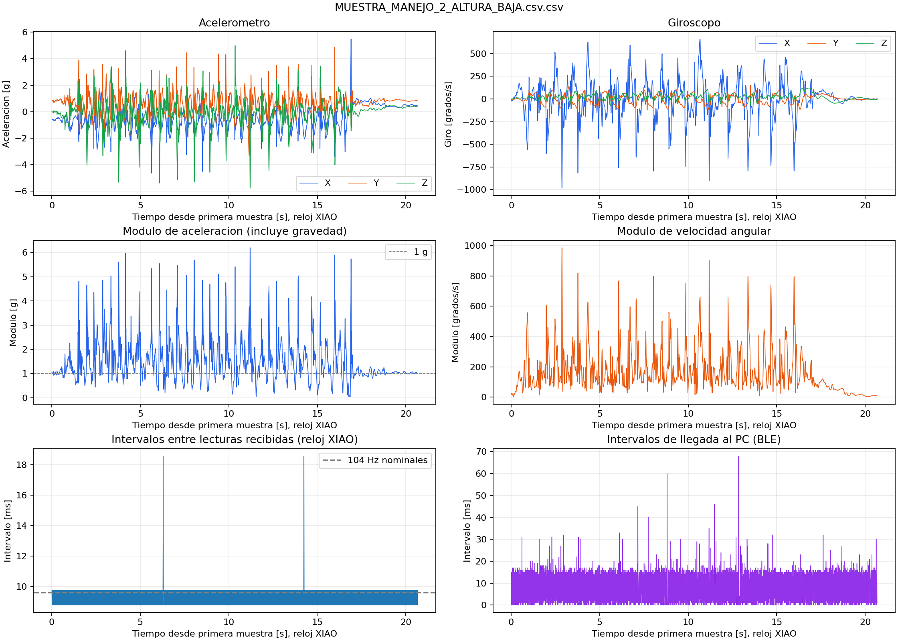
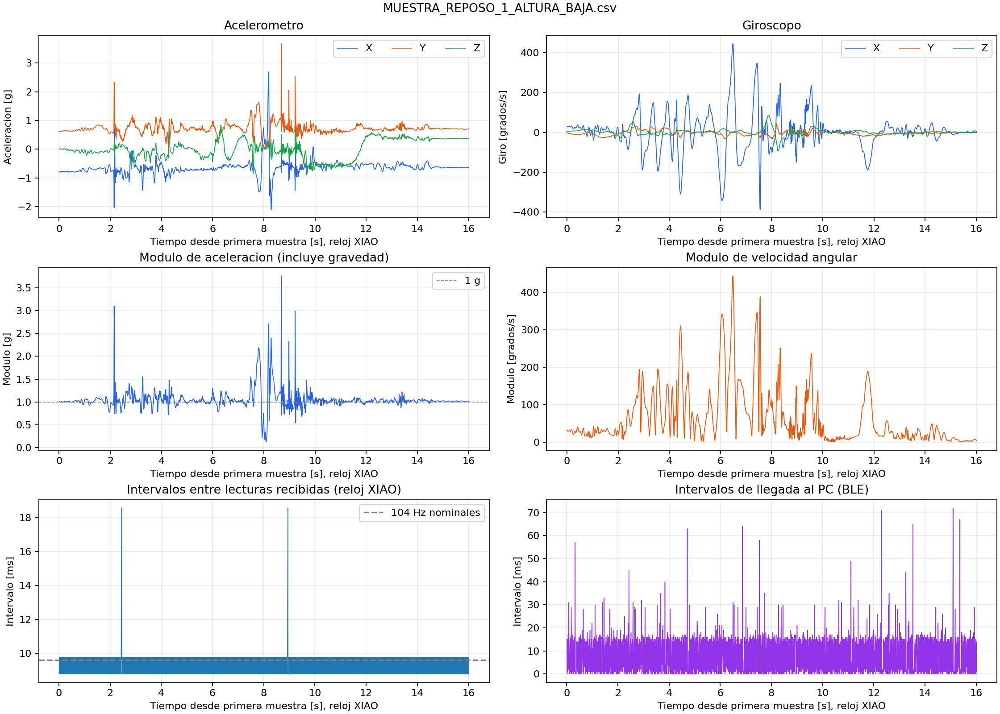
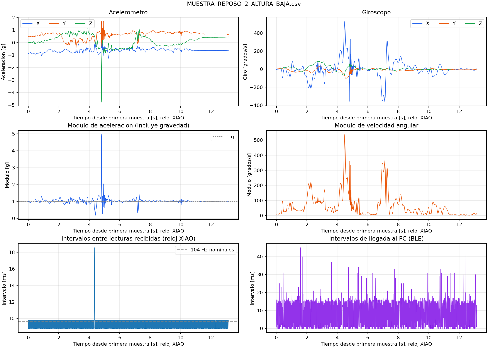

# Experimento 1: primera prueba del sensor en un stick de hockey

**Fecha:** 21/11/2026. **Prototipo:** [01_ble_imu](../../../code/prototipos/01_ble_imu/README.md).

## Objetivo y montaje

Comprobar la sujeción y comodidad del prototipo, verificar la recepción de medidas
y explorar las diferencias entre reposo y manejo del puck.

Se colocó la XIAO nRF52840 Sense en la zona inferior del stick de Diego. Se tomaron
medidas de aceleración y velocidad angular en los tres ejes, en condiciones
identificadas como reposo y manejo de un puck de hockey sobre hielo sobre una
superficie de plástico. «Altura baja» identifica la colocación inferior del sensor;
no se registró una distancia exacta en centímetros.

El diseño mecánico pareció mantener el sensor sujeto y no se percibió una diferencia
importante de peso. Son observaciones iniciales y subjetivas, sin ensayo específico
de resistencia ni valoración con varios jugadores.

## Capturas realizadas

Los nombres de los archivos identifican la condición prevista y la repetición,
no etiquetas temporales verificadas dentro de cada captura.

| CSV original | Condición prevista | Repetición | Posición | Muestras | Duración (s) | Frecuencia estimada (Hz) | Saltos |
| --- | --- | --- | --- | ---: | ---: | ---: | ---: |
| [MUESTRA_MANEJO_1_ALTURA_BAJA.csv](MUESTRA_MANEJO_1_ALTURA_BAJA.csv) | Manejo del puck | 1 | Inferior del stick | 2056 | 19.298 | 106.49 | 0 |
| [MUESTRA_MANEJO_2_ALTURA_BAJA.csv.csv](MUESTRA_MANEJO_2_ALTURA_BAJA.csv.csv) | Manejo del puck | 2 | Inferior del stick | 2201 | 20.669 | 106.44 | 0 |
| [MUESTRA_REPOSO_1_ALTURA_BAJA.csv](MUESTRA_REPOSO_1_ALTURA_BAJA.csv) | Reposo (con movimiento en la captura) | 1 | Inferior del stick | 1705 | 16.013 | 106.42 | 0 |
| [MUESTRA_REPOSO_2_ALTURA_BAJA.csv](MUESTRA_REPOSO_2_ALTURA_BAJA.csv) | Reposo (con movimiento en la captura) | 2 | Inferior del stick | 1400 | 13.141 | 106.46 | 0 |

La segunda captura de manejo conserva su nombre original con doble extensión
`.csv.csv`; es un único archivo CSV, no dos registros.

## Adquisición y recepción

El firmware está configurado a **104 Hz nominales** y transmite por BLE a un PC.
La lectura de la IMU y el envío se ejecutan por separado, con un búfer intermedio.
El PC guarda todas las notificaciones durante cada sesión iniciada con `start`
y finalizada con `stop`, aunque la terminal solo muestre una parte de las muestras.

Las frecuencias de la tabla se calculan como incremento del contador dividido
por el tiempo transcurrido según la XIAO. Las cuatro capturas presentan cero saltos
entre lecturas recibidas. Esto no demuestra que no se hayan perdido conversiones
antes de leer la IMU: el firmware no utiliza su FIFO. Tampoco certifica un intervalo
perfectamente uniforme entre todas las lecturas.

La aceleración se expresa en **g** e incluye gravedad; el giro se expresa en **°/s**.
Las señales se analizan sin filtrado ni calibración. Los rangos no figuran en los
CSV, por lo que deben anotarse en futuras sesiones para documentar la saturación.

## Comparación de las señales

| Captura | Desv. ax (g) | Desv. ay (g) | Desv. az (g) | Desv. gx (°/s) | Máximo absoluto de giro por eje (°/s) |
| --- | ---: | ---: | ---: | ---: | ---: |
| MUESTRA_MANEJO_1_ALTURA_BAJA.csv | 0.860 | 0.809 | 1.037 | 229.51 | 982.0 |
| MUESTRA_MANEJO_2_ALTURA_BAJA.csv.csv | 0.864 | 0.771 | 1.010 | 204.91 | 984.8 |
| MUESTRA_REPOSO_1_ALTURA_BAJA.csv | 0.271 | 0.217 | 0.327 | 97.36 | 443.9 |
| MUESTRA_REPOSO_2_ALTURA_BAJA.csv | 0.151 | 0.277 | 0.470 | 94.99 | 529.8 |

Se usa la desviación típica poblacional de toda la captura, sin seleccionar ventanas.
El máximo de giro corresponde a un eje individual, no al módulo del vector.

- **Manejo 1 y 2:** presentan mayor variabilidad de aceleración en los tres ejes
  y mayor variabilidad de giro X que las capturas denominadas reposo. Las dos
  repeticiones muestran magnitudes de variación similares.
- **Reposo 1 y 2:** no representan inmovilidad continua. Alcanzan máximos absolutos
  de giro de 443,9 y 529,8 °/s, respectivamente. Estos cambios deben revisarse y
  segmentarse antes de utilizar los archivos como ejemplos de una clase «quieto»
  o para estimar el offset del giróscopo.
- **Gráfica de reposo 1:** se observan movimientos entre aproximadamente 2 y 10 s,
  además de un cambio alrededor de 12 s. No se dispone de vídeo ni anotaciones
  temporales para atribuirlos a acciones concretas.
- **Recepción BLE:** las gráficas distinguen los intervalos de lectura de la XIAO
  de los intervalos de llegada al PC. Una llegada por ráfagas no implica por sí
  sola pérdida de datos ni cambios equivalentes en el muestreo del sensor.

## Gráficas de cada captura

En cada figura se muestran acelerómetro XYZ, giróscopo XYZ, módulos de aceleración
y giro, intervalos de lectura de la XIAO e intervalos de llegada al PC.
Las escalas verticales se ajustan por figura: para comparar amplitudes deben
consultarse los valores de los ejes y la tabla anterior.

### MUESTRA MANEJO 1 ALTURA BAJA

[Resumen](MUESTRA_MANEJO_1_ALTURA_BAJA/resumen.txt) · [Estadísticas](MUESTRA_MANEJO_1_ALTURA_BAJA/estadisticas.csv) · [Datos analizados](MUESTRA_MANEJO_1_ALTURA_BAJA/datos_analizados.csv)

### MUESTRA MANEJO 2 ALTURA BAJA

[Resumen](MUESTRA_MANEJO_2_ALTURA_BAJA.csv/resumen.txt) · [Estadísticas](MUESTRA_MANEJO_2_ALTURA_BAJA.csv/estadisticas.csv) · [Datos analizados](MUESTRA_MANEJO_2_ALTURA_BAJA.csv/datos_analizados.csv)

### MUESTRA REPOSO 1 ALTURA BAJA

[Resumen](MUESTRA_REPOSO_1_ALTURA_BAJA/resumen.txt) · [Estadísticas](MUESTRA_REPOSO_1_ALTURA_BAJA/estadisticas.csv) · [Datos analizados](MUESTRA_REPOSO_1_ALTURA_BAJA/datos_analizados.csv)

### MUESTRA REPOSO 2 ALTURA BAJA

[Resumen](MUESTRA_REPOSO_2_ALTURA_BAJA/resumen.txt) · [Estadísticas](MUESTRA_REPOSO_2_ALTURA_BAJA/estadisticas.csv) · [Datos analizados](MUESTRA_REPOSO_2_ALTURA_BAJA/datos_analizados.csv)

## Conclusiones y límites

El montaje permitió realizar cuatro capturas y recibir las lecturas en el PC
con una frecuencia estimada de unos 106,4 Hz y sin saltos del contador. Las señales
de manejo tienen mayor variabilidad que las de reposo, pero estas últimas incluyen
movimiento. Por tanto, todavía no constituyen un conjunto de clases limpias ni
permiten afirmar que puedan clasificarse gestos concretos con fiabilidad.

En la prueba se indicó que no se observó saturación. Los datos por sí solos no
permiten certificarlo sin conocer los rangos usados en cada sesión. El resultado
tampoco debe extrapolarse a tiros, golpes o acciones más intensas.

La adquisición fue exploratoria y sobre plástico, no sobre hielo. Para el siguiente
experimento conviene registrar rangos, orientación y posición exacta, identificar
la versión de Git, tomar un reposo continuo para calibración y delimitar las acciones
mediante anotaciones o vídeo sincronizado. Los CSV originales se conservan sin cambios.
