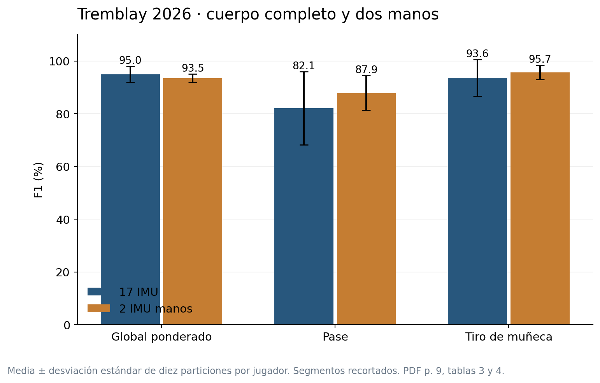
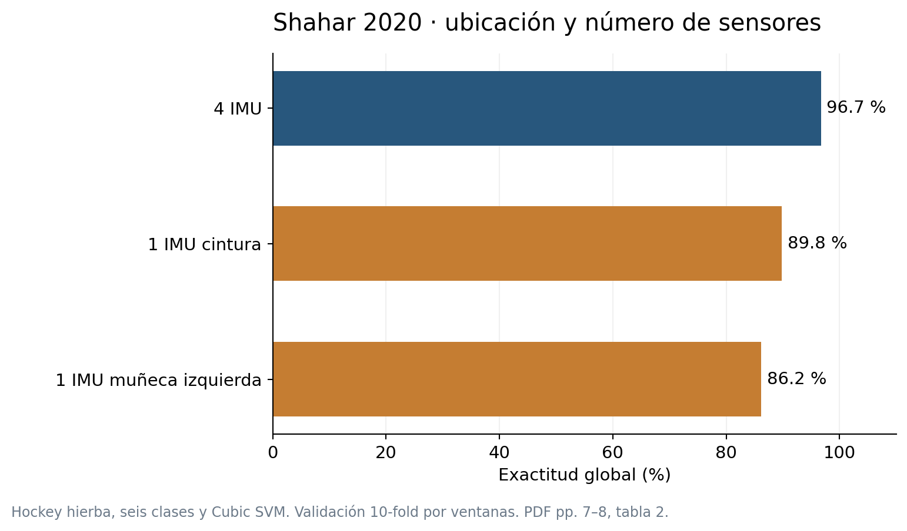

# Comparación de resultados según la ubicación de los sensores

Este documento analiza qué permiten concluir las siete publicaciones seleccionadas sobre la posición de los sensores. La evidencia más directa procede de comparaciones realizadas dentro del mismo estudio. Los resultados dependen también del número de sensores, las señales de entrada, el algoritmo, las clases y la validación.

Los identificadores P1 a P7 coinciden con el [estado del arte](estado-del-arte.md) y la [matriz de evidencia](matriz-de-evidencia-hockey-inercial.xlsx). El análisis ha sido elaborado por un agente de IA a partir de la extracción disponible y contrastes puntuales con los PDF locales.

## Qué compara cada publicación

| Publicación | Ubicaciones estudiadas | Comparación que permite realizar |
| --- | --- | --- |
| P1 · Tremblay 2026 | Cuerpo completo con 17 IMU y ambas manos dentro de los guantes. | Compara dos conjuntos de señales, 17 sensores frente a dos manos. No desglosa el rendimiento de cada una de las 17 posiciones. |
| P2 · Phillips 2025 | Cuerpo completo, ambas manos y ambas manos más esternón. | Compara 17, 2 y 3 sensores con CNN, Transformer e híbrido. Permite observar el efecto de añadir esternón al conjunto de las manos. |
| P3 · Shahar 2025 | Pecho, cintura y ambas muñecas. | Los resultados extraídos corresponden a cuatro IMU y distintas características o modelos. La comparación de clasificadores no aísla el efecto de cada ubicación. |
| P4 · Léger 2022 | Mano superior e inferior en el agarre del palo, con IMU dentro de los guantes. | Compara canales de aceleración y giro de ambas manos para clasificar la respuesta a distintos palos. |
| P5 · Hardegger 2015 | IMU en el pomo del palo y montaje corporal con ambas muñecas y tronco. | Describe sistemas con sensores, objetivos y protocolos diferentes. Sus resultados requieren interpretación por módulo. |
| P6 · Shahar 2020 | Pecho, cintura, muñeca derecha y muñeca izquierda, individualmente y combinadas. | Compara posiciones corporales con el mismo clasificador y seis clases de hockey hierba. Es la comparación más directa de ubicaciones individuales en el corpus. |
| P7 · Vleugels 2021 | IMU en palo y otra en muñeca del lado de tiro durante la adquisición. | La sección 3.2.2 indica que los datos de muñeca no se utilizaron. Los resultados publicados corresponden a la señal del palo. |

## Tremblay y las 17 IMU

Tremblay coloca los sensores según el montaje corporal de Xsens y utiliza dos configuraciones de entrada para el modelo FCN. La configuración completa utiliza 51 canales de aceleración de 17 IMU. La configuración reducida utiliza seis canales de aceleración de ambas manos. El procesamiento trabaja a 240 Hz con segmentos ajustados a 2,4 s y pruebas con jugadores separados. La evaluación permite estudiar la reducción del conjunto de sensores.

| Resultado | 17 IMU corporales | 2 IMU en las manos | Diferencia de manos respecto al cuerpo completo |
| --- | ---: | ---: | ---: |
| F1 global ponderado | 95,0 ± 3,0 % | 93,5 ± 1,6 % | −1,5 puntos porcentuales |
| F1 de pase | 82,1 ± 13,9 % | 87,9 ± 6,6 % | +5,8 puntos porcentuales |
| F1 de tiro de muñeca | 93,6 ± 6,9 % | 95,7 ± 2,7 % | +2,1 puntos porcentuales |
| Precisión de pase | 80,1 ± 19,0 % | 88,3 ± 7,9 % | +8,2 puntos porcentuales |
| Sensibilidad de pase | 86,3 ± 12,2 % | 88,5 ± 10,9 % | +2,2 puntos porcentuales |
| Precisión de tiro de muñeca | 96,2 ± 3,4 % | 94,4 ± 5,2 % | −1,8 puntos porcentuales |
| Sensibilidad de tiro de muñeca | 91,6 ± 10,9 % | 97,2 ± 2,6 % | +5,6 puntos porcentuales |

Los valores son medias y desviaciones estándar de diez particiones. Las diferencias se han calculado restando las medias publicadas. Su signo describe el cambio observado y la significación estadística requiere un análisis específico. Fuente en P1, PDF p. 9, tablas 3 y 4.

Las manos conservan un F1 global próximo al del cuerpo completo y alcanzan medias mayores en pase y tiro de muñeca. Para tiro de muñeca, el aumento de sensibilidad se acompaña de una reducción de precisión. Este equilibrio resulta relevante para el proyecto, que prioriza pocas falsas detecciones.

**El estudio no identifica la mejor ubicación individual.** La comparación combina cambios en número de sensores y canales disponibles. Quedan sin resolver el rendimiento de una sola mano, una sola muñeca, antebrazo o pecho y la comparación con el palo. La posición en la mano dentro del guante también debe distinguirse de la colocación en la muñeca. [P1](#referencias).

## Phillips y la aportación del esternón

Phillips compara tres conjuntos de sensores con tres familias de modelos. Todos utilizan aceleración procesada a 240 Hz y eventos recortados en condiciones de juego simulado con jugadores reales.

| Modelo | 17 IMU corporales | Ambas manos y esternón, 3 IMU | Ambas manos, 2 IMU | Cambio al añadir esternón a las manos |
| --- | ---: | ---: | ---: | ---: |
| CNN | 81,8 % | 79,8 % | 76,9 % | +2,9 puntos porcentuales |
| Transformer | 77,2 % | 73,8 % | 72,2 % | +1,6 puntos porcentuales |
| Híbrido CNN-Transformer | 81,6 % | 83,7 % | 80,4 % | +3,3 puntos porcentuales |

La métrica es F1 global. Los cambios se calculan dentro de cada familia de modelos. Los valores proceden de la tabla 5, PDF p. 62. Para el híbrido de dos manos, esa tabla informa 80,4 %, mientras el texto de la p. 69 menciona 80,8 %. La tabla anterior conserva el valor de la tabla 5 y deja registrada la discrepancia.

Añadir esternón a las dos manos mejora el F1 medio reportado en las tres familias. El mejor conjunto depende del modelo. La CNN y el Transformer alcanzan sus valores mayores con 17 IMU, mientras el híbrido alcanza el mayor con tres. El efecto observado corresponde al conjunto de entrada y al entrenamiento de cada modelo. La utilidad aislada del esternón requeriría evaluarlo como configuración propia. [P2](#referencias).

## Shahar 2020 y la comparación directa de ubicaciones

Este trabajo compara señales de pecho, cintura y ambas muñecas a 200 Hz. Utiliza acelerómetro y giróscopo, características temporales, ventanas de 0,64 s y Cubic SVM para seis clases de hockey hierba. Entre ellas figuran pase, recepción y regate.

| Ubicación o conjunto | Número de IMU | Exactitud global |
| --- | ---: | ---: |
| Pecho | 1 | 65,5 % |
| Muñeca derecha | 1 | 63,8 % |
| Cintura | 1 | 89,8 % |
| Muñeca izquierda | 1 | 86,2 % |
| Pecho, cintura y ambas muñecas | 4 | 96,7 % |

La tabla recoge las cuatro ubicaciones individuales y el montaje completo. El artículo también compara combinaciones intermedias. Los valores proceden de la tabla 2 y su discusión, PDF pp. 7–8. La diferencia entre cintura y muñeca izquierda es de 3,6 puntos porcentuales y entre cuatro sensores y muñeca izquierda de 10,5 puntos porcentuales.

La cintura obtiene la mayor exactitud entre las posiciones individuales evaluadas. La muñeca izquierda obtiene un resultado próximo y ambas superan pecho y muñeca derecha. La cifra global agrega las seis clases, por lo que el orden de ubicaciones para recepción o regate por separado necesita resultados por clase. La validación es 10-fold por ventanas y la separación por jugador sigue pendiente de comprobar.

La lateralidad debe conservarse como izquierda o derecha al citar el resultado. La equivalencia con mano dominante, no dominante, superior o inferior requiere revisar el agarre y las características de los participantes. La transferencia a hockey línea también debe considerar el cambio de bola, disco, palo y superficie. [P6](#referencias).

## Léger y las diferencias entre mano superior e inferior

Léger utiliza dos IMU integradas en guantes y compara las magnitudes resultantes de aceleración y velocidad angular de ambas manos. La mano superior es la más próxima al pomo y la inferior se coloca más cerca de la pala. La variable de salida del modelo es la respuesta del jugador al ajuste del palo según velocidad del disco, con el tiro previamente identificado.

| Gesto y parámetro del palo | Aceleración de mano superior | Giro de mano superior | Aceleración de mano inferior | Giro de mano inferior |
| --- | ---: | ---: | ---: | ---: |
| Slap shot, rigidez o flex | 95 % | 95 % | 93 % | 96 % |
| Slap shot, curva de pala | 95 % | 95 % | 90 % | 98 % |
| Slap shot, kick point | 93 % | 96 % | 94 % | 97 % |
| Tiro de muñeca, rigidez o flex | 93 % | 95 % | 97 % | 96 % |
| Tiro de muñeca, curva de pala | 93 % | 93 % | 96 % | 95 % |
| Tiro de muñeca, kick point | 94 % | 97 % | 96 % | 94 % |

La métrica es exactitud de clasificación de respuesta al palo. Los porcentajes se reproducen de las tablas 6 y 7 del artículo, PDF pp. 8–9. El ajuste utiliza PCA y Fine KNN. Las matrices de confusión posteriores presentan otros valores para los modelos destacados, como 97,3 % para slap shot flex y 96,1 % para wrist shot flex. La correspondencia entre ambas presentaciones necesita aclaración y cada conjunto se cita con su tabla o figura.

El giro de la mano inferior obtiene los mayores valores de las tablas para los tres parámetros en slap shot. En tiro de muñeca, los mejores resultados cambian entre aceleración de la mano inferior y giro de la superior según el parámetro. Esto aporta una razón para estudiar ubicación y tipo de señal conjuntamente. La capacidad para distinguir pase de tiro o detectar el inicio de una recepción debe evaluarse con esas salidas como objetivo. [P4](#referencias).

## Sensores en el palo

| Trabajo y montaje | Resultado | Alcance de la comparación de ubicaciones |
| --- | --- | --- |
| P7 · Una Axivity AX6 fijada al palo | Exactitud 76 % para seis clases con jugadores no vistos. 99 % cuando entrenamiento y prueba contienen datos de los mismos jugadores. En tres secuencias continuas, 23/24 tiros correctos y un regate clasificado como tiro. | Se adquirieron datos de otra IMU en muñeca del lado de tiro, pero la sección 3.2.2 indica que no se utilizaron. Las diferencias de exactitud anteriores proceden del protocolo de validación. |
| P5 · IMU Bosch BNO055 en el pomo, más galgas y sensores de posición de manos | Exactitud 100 % en clasificación de tipo de tiro en un subconjunto de 100 tiros preseleccionados por problemas de pérdida de datos. | El modelo utiliza un palo instrumentado con varias tecnologías. La contribución exclusiva de la IMU o su posición dentro del palo requiere una comparación específica. |
| P5 · GameTracker con ambas muñecas y tronco | F1 global de eventos de 0,70, precisión 0,73 y sensibilidad aproximada 0,67. | Evalúa otro módulo y otro conjunto de eventos con protocolo diferente al palo sensorizado. |

En P7, los datos se adquieren a 400 Hz y se reducen a 100 Hz para el procesamiento descrito. La sección 3.2.2, PDF p. 6, documenta ambos dispositivos y el descarte de los datos de muñeca. Los resultados del modelo y del ensayo continuo aparecen en PDF pp. 8–11. En P5, el montaje de palo y su evaluación aparecen en PDF pp. 3–4 y GameTracker en pp. 5–6. [P5 y P7](#referencias).

Los tres resultados muestran viabilidad en sus condiciones experimentales. Las diferencias de sensores, clases, muestras y selección de datos impiden atribuir la diferencia numérica entre ellos exclusivamente a palo, muñeca o tronco.

## Shahar 2025 y la selección de características

P3 utiliza cuatro IMU en pecho, cintura y ambas muñecas, con acelerómetro y giróscopo a 128 Hz. Compara selección de características y clasificadores. La configuración RNCA reduce la entrada de 432 a 83 características. K-NN obtiene exactitud de 92,82 % y macro F1 de 86,91 %, mientras MLP obtiene 94,13 % y 89,09 %, respectivamente, según las tablas 2 y 3, PDF pp. 17–18.

La selección de características puede orientar qué señales estudiar, pero para elegir una ubicación es necesario relacionar cada característica seleccionada con su sensor de origen y evaluar configuraciones que retiren ubicaciones completas. Los resultados globales extraídos de este trabajo se obtienen del conjunto de cuatro sensores. [P3](#referencias).

## Conclusiones para comparar palo y muñeca

1. **Tremblay permite justificar un montaje reducido en las manos.** Su diseño deja pendiente la elección de una ubicación individual entre las 17 disponibles.
2. **Shahar 2020 aporta la comparación más directa de posiciones corporales individuales.** Sus resultados favorecen cintura y muñeca izquierda en el conjunto de seis clases de hockey hierba, con las limitaciones de validación descritas.
3. **Phillips muestra que el esternón puede aportar información al conjunto de las manos.** La magnitud de mejora depende de la familia de modelo.
4. **Léger encuentra diferencias entre señales y manos según el parámetro del tiro.** Sus resultados se interpretan dentro de la tarea de ajuste del palo.
5. **Vleugels aporta la referencia más próxima al uso de una sola IMU en el palo.** Aunque colocó otro sensor en muñeca, sus resultados publicados no comparan ambas señales.

La evidencia recuperada deja abierta la comparación controlada de palo frente a una muñeca para los cuatro gestos del proyecto. Para resolverla, la propuesta metodológica del agente es registrar ambas ubicaciones simultáneamente, conservar la misma referencia de vídeo y comparar cada entrada con los mismos jugadores, particiones, ventanas y modelo. Esto permitiría medir el efecto de ubicación con precisión por gesto, sensibilidad y falsas detecciones por minuto. La elección de mano, lado, orientación y punto de fijación debe quedar documentada.

## Referencias

- **P1.** Tremblay et al. (2026). *A Deep Learning Approach to Automatically Classify Ice Hockey Shooting Actions Using Acceleration Signals*. [DOI](https://doi.org/10.3390/s26113361) · [PDF](papers/utiles/A%20Deep%20Learning%20Approach%20to%20Automatically%20Classify%20Ice%20Hockey%20Shooting%20Actions%20Using%20Acceleration%20Signals.pdf).
- **P2.** Phillips (2025). *Assessing Deep Learning Techniques for Ice Hockey Human Activity Recognition from Game Simulated Inertial Measurement Unit Data: A Comparative Analysis of CNN, Transformer, and Hybrid Models*. Tesis de máster, McGill University. [PDF](papers/utiles/Assessing%20Deep%20Learning%20Techniques%20for%20Ice%20Hockey%20Human%20Activity%20Recognition%20from.pdf).
- **P3.** Shahar et al. (2025). *Inertial Sensor-Based Recognition of Field Hockey Activities Using a Hybrid Feature Selection Framework*. [DOI](https://doi.org/10.3390/s25247615) · [PDF](papers/utiles/Inertial%20Sensor-Based%20Recognition%20of%20Field%20Hockey%20Activities%20Using%20a%20Hybrid%20Feature%20Selection%20Framework.pdf).
- **P4.** Léger et al. (2022). *Pilot Study of Embedded IMU Sensors and Machine Learning Algorithms for Automated Ice Hockey Stick Fitting*. [DOI](https://doi.org/10.3390/s22093419) · [PDF](papers/utiles/Pilot%20Study%20of%20Embedded%20IMU%20Sensors%20and%20Machine%20Learning%20Algorithms%20for%20Automated%20Ice%20Hockey%20Stick%20Fitting.pdf).
- **P5.** Hardegger et al. (2015). *Sensor Technology for Ice Hockey and Skating*. [DOI](https://doi.org/10.1109/BSN.2015.7299368) · [PDF](papers/utiles/Sensor%20Technology%20for%20Ice%20Hockey%20and%20Skating.pdf).
- **P6.** Shahar et al. (2020). *Wearable Inertial Sensor for Human Activity Recognition in Field Hockey: Influence of Sensor Combination and Sensor Location*. [DOI](https://doi.org/10.1088/1742-6596/1529/2/022015) · [PDF](papers/utiles/Shahar%202020%20-%20Wearable%20Inertial%20Sensor%20for%20Human%20Activity%20Recognition%20in%20Field%20Hockey.pdf).
- **P7.** Vleugels et al. (2021). *Ultra-Wideband Indoor Positioning and IMU-Based Activity Recognition for Ice Hockey Analytics*. [DOI](https://doi.org/10.3390/s21144650) · [PDF](papers/utiles/Ultra-Wideband%20Indoor%20Positioning%20and%20IMU-Based%20Activity%20Recognition%20for%20Ice%20Hockey%20Analytics.pdf).
