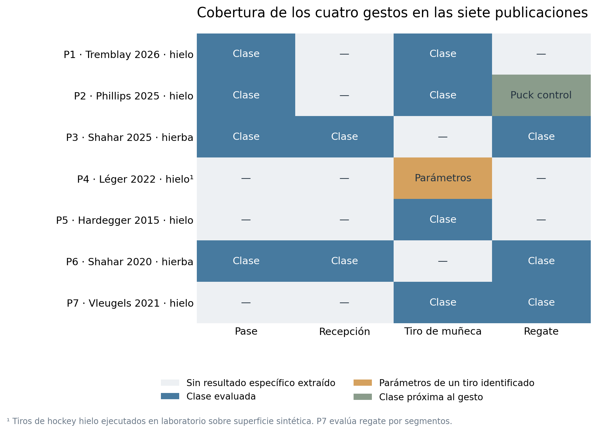
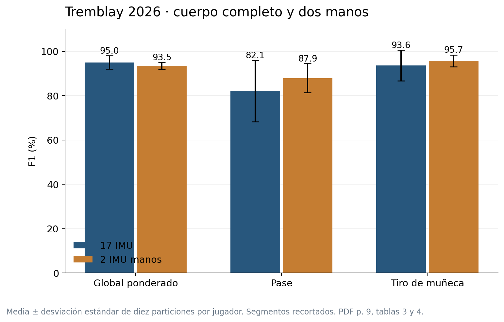
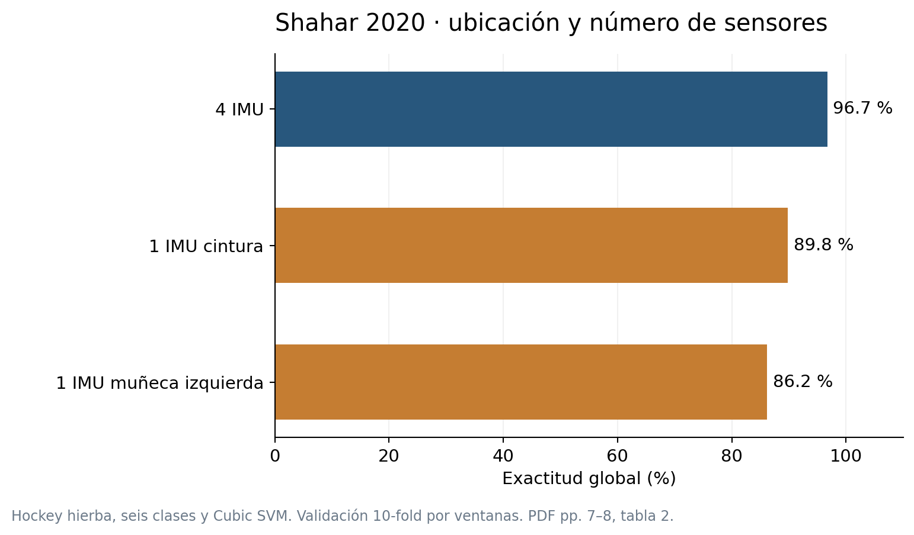
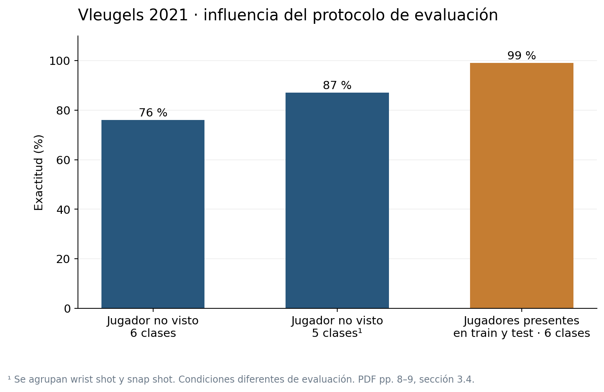

# Estado del arte de la detección de gestos de hockey mediante sensores inerciales

## Resumen

La literatura seleccionada muestra que las señales inerciales permiten clasificar pases, tiros y acciones de manejo del disco o la bola con sensores en manos, muñecas, tronco o palo. Los siete trabajos retenidos aportan evidencia de clasificación y métodos de adquisición, segmentación y evaluación. La aplicación a una sesión continua de hockey línea en estático sobre hormigón sigue requiriendo validación propia, especialmente para recepción, rechazo de movimientos ajenos y control de falsas detecciones.

Este documento sintetiza el planteamiento, la búsqueda, la selección, los resultados y las conclusiones disponibles en el proyecto. La [matriz de evidencia](matriz-de-evidencia-hockey-inercial.xlsx) conserva los datos y niveles de verificación. El [informe de extracción](entregable-paso-3.md) contiene las tablas completas y el registro de correcciones de NotebookLM. La síntesis y las conclusiones han sido elaboradas por un agente de IA y quedan pendientes de revisión académica por Diego.

## Problema y pregunta de investigación

El proyecto busca registrar automáticamente los gestos de los jugadores para apoyar el análisis de entrenamientos y, como aplicación futura, las estadísticas posteriores a un partido. La primera validación se centrará en jugadores de hockey línea de 15 a 20 años, de nivel intermedio a avanzado, que ejecutarán pase, recepción de pase, tiro de muñeca y regate en estático sobre hormigón.

La pregunta de investigación es qué configuraciones de sensores con acelerómetro se han evaluado para reconocer esos gestos en hockey línea o hielo, y qué aciertos y falsas detecciones reportan frente a una referencia etiquetada. Se compararán la ubicación en palo o muñeca, la resolución de los datos y distintas combinaciones de acelerómetro, giróscopo y magnetómetro. El sistema procesará una grabación continua mediante ventanas deslizantes y una categoría undefined. Se prioriza reducir falsas detecciones, aceptando algunas omisiones. La duración de ventana, el paso y los umbrales aceptables siguen por definir. [Planteamiento PICOS](README.md) y [decisiones del proyecto](notas/preguntas-y-respuestas.md).

| Componente PICOS | Alcance de la revisión |
| --- | --- |
| Población | Jugadores reales de hockey línea o hielo. La revisión personal incorpora dos trabajos de hockey hierba por su utilidad metodológica. |
| Intervención | Reconocimiento de gestos mediante acelerometría, sola o combinada con señales inerciales. Se incorpora un trabajo de parámetros de tiros y ajuste del palo. |
| Comparador | Vídeo, anotación manual u otra referencia etiquetada. Se registran las configuraciones alternativas que compare cada trabajo. |
| Resultados | Sensibilidad por gesto, precisión, F1 y falsas detecciones cuando estén disponibles. El cribado original exigía sensibilidad superior al 50 % y falsas detecciones cuantificables para al menos un gesto. |
| Diseño | Evaluación experimental con datos reales. Se distingue entre segmentos recortados, clasificación por ventanas y detección de eventos en continuo. |

## Búsqueda y selección documental

La búsqueda documentada combina IEEE Xplore, PubMed y referencias procedentes de Consensus y Elicit. Las cadenas, sus filtros y los motivos de exclusión constan en el [cribado de IA](cribado-de-papers-ia.md). Las decisiones personales posteriores constan en el [cribado de Diego](cribado-de-papers.md).

| Fuente o fase | Resultados documentados | Cobertura y pendientes |
| --- | --- | --- |
| IEEE Xplore, consulta 1 | 24 resultados, 20 de congresos y 4 de revistas. Se aportaron 3 PDF. | Quedan 21 registros por identificar y cotejar. |
| IEEE Xplore, consulta 2 | 12 resultados y 12 PDF, con 4 publicaciones ya presentes en el corpus. | Las dos descargas de IEEE suman 12 publicaciones distintas. |
| PubMed | 36 resultados con Full text en la consulta amplia y 5 en la refinada. | Los 5 tienen PDF local. La consulta refinada emitió avisos de frases. El recuento de la variante corregida está pendiente. |
| Consensus y Elicit | Lista de Consensus con 20 DOI distintos y PDF previamente archivados desde Elicit. | El total mostrado por las interfaces no está registrado. |
| Corpus organizado | 37 publicaciones y 36 PDF locales. | El recuento corresponde al corpus recuperado y organizado. |
| Cribado original de IA | 4 publicaciones incluidas y 33 excluidas. | Decisiones basadas en el PICOS original. |
| Revisión personal iniciada | 7 publicaciones retenidas provisionalmente y 30 excluidas provisionalmente. | Diego confirmó 3 inclusiones adicionales. Las otras 34 decisiones conservan el criterio de IA y están pendientes de su revisión. |

La ampliación incorpora Léger 2022 por los parámetros de los tiros y Shahar 2020 y 2025 por la clasificación, ubicación y frecuencia de muestreo. La búsqueda conserva pendientes de cobertura y verificación que deben resolverse antes de presentar un flujo PRISMA cerrado o afirmar exhaustividad. Las siete publicaciones pueden compartir líneas de investigación o datos. Su número expresa publicaciones retenidas y la independencia de sus cohortes requiere comprobación.

## Evidencia seleccionada

Los identificadores P1 a P7 siguen la extracción de NotebookLM. Cada porcentaje se interpreta junto al gesto, la configuración y el protocolo de evaluación.

| ID y referencia | Montaje y muestreo | Muestra descrita | Aportación y resultado principal |
| --- | --- | --- | --- |
| P1 · Tremblay et al. (2026) | 17 IMU o 2 manos, aceleración procesada, 240 Hz. | 43 reclutados y 39 analizados. | Clasificación de segmentos de siete acciones. Con dos manos, F1 global ponderado de 93,5 ± 1,6 %. Pase con precisión 88,3 % y sensibilidad 88,5 %. Tiro de muñeca con sensibilidad 97,2 %. PDF p. 9, tablas 3–4. |
| P2 · Phillips (2025) | 17, 3 o 2 IMU, aceleración procesada, 240 Hz. | 51 reclutados y 48 analizados. | Ocho clases en condiciones de juego simulado con datos reales. El híbrido con manos y esternón alcanza F1 global ponderado de 83,7 %. Pase con precisión 77,3 % y sensibilidad 93,5 %. PDF p. 62, tablas 5–6. |
| P3 · Shahar et al. (2025) | 4 IMU corporales, acelerómetro y giróscopo, 128 Hz. | 43 participantes de hockey hierba según extracción. | Selección de 432 a 83 características. K-NN/RNCA con exactitud 92,82 ± 0,92 % y macro F1 86,91 ± 1,67 %. MLP/RNCA con exactitud 94,13 ± 0,70 % y macro F1 89,09 ± 1,70 %. PDF pp. 17–18, tablas 2–3. |
| P4 · Léger et al. (2022) | 2 IMU en guantes, acelerómetro y giróscopo, 200 Hz. | 10 jugadores adultos experimentados. | Tiros estáticos sobre superficie sintética en laboratorio. Clasifica la respuesta al ajuste de palo a partir de tiros identificados. Para tiro de muñeca, exactitud de fitting entre 94,5 y 96,1 %, según parámetro y canal. PDF pp. 9–11. |
| P5 · Hardegger et al. (2015) | Palo con IMU y sensores de flexión y posición. GameTracker con 3 IMU corporales a 100 Hz. | Palo con 19 jugadores. GameTracker con 4 profesionales y 10 rondas. | GameTracker detecta eventos en continuo con F1 global 0,70, precisión 0,73 y sensibilidad aproximada 0,67. El 100 % del módulo de palo corresponde a 100 tiros preseleccionados tras problemas de registro. PDF pp. 4–6. |
| P6 · Shahar et al. (2020) | 4 IMU o sensores individuales en distintas ubicaciones, 200 Hz. | 11 jugadores de hockey hierba. | Seis clases, incluidas pase, recepción y regate. Cubic SVM alcanza exactitud global 96,7 % con cuatro sensores, 89,8 % en cintura y 86,2 % en muñeca izquierda. PDF pp. 7–8, tabla 2. |
| P7 · Vleugels et al. (2021) | 1 IMU en palo, acelerómetro y giróscopo, procesamiento a 100 Hz. | 5 jugadores. | CNN con exactitud 76 % para jugadores no vistos y 99 % al repartir datos de los mismos jugadores entre entrenamiento y prueba. En tres repeticiones continuas, 23/24 tiros correctos y un regate clasificado como tiro. PDF pp. 8–11. |

### Cobertura de los gestos

**Figura 1.** Cobertura descriptiva a partir de los objetivos y clases de P1–P7. La celda vacía indica ausencia de un resultado específico en la extracción. Puck control en P2 agrupa una actividad más amplia que el regate. P4 analiza parámetros de tiros ya identificados. P7 evalúa el regate como clase de segmentos y filtra sus picos en la demostración continua de tiros.

La recepción presenta el vacío más claro respecto al contexto de hockey línea. Los dos estudios de hierba la incluyen entre sus clases y aportan métodos de adquisición y clasificación. Su rendimiento necesita comprobarse con disco, palo, superficie y población del proyecto. El corpus también deja pendiente la validación conjunta de los cuatro gestos como eventos en una misma sesión continua de hockey línea. [P1–P7](#referencias).

## Síntesis de los métodos y resultados

### Ubicación y número de sensores

**Figura 2.** Comparación dentro de P1 con el mismo tipo de modelo y protocolo. Las barras muestran media y desviación estándar de diez particiones por jugador. El F1 global es ponderado. Las diferencias entre configuraciones son descriptivas y requieren análisis estadístico para valorar su consistencia. Fuente en P1, PDF p. 9, tablas 3–4.

P1 muestra que un montaje reducido en ambas manos conserva capacidad de clasificación de las acciones evaluadas. El pase presenta mayor variabilidad que el resultado global. P7 aporta un montaje en palo y P6 una comparación de ubicaciones corporales. La extracción no contiene una comparación controlada de una sola muñeca frente al palo con los mismos jugadores, gestos y condiciones. Esta comparación constituye una aportación concreta del experimento propuesto. [P1, P6 y P7](#referencias).

**Figura 3.** Comparación dentro de P6 con Cubic SVM y seis clases de hockey hierba. Los valores de cintura y muñeca izquierda se han corregido frente a la respuesta original de NotebookLM. El protocolo utiliza validación 10-fold por ventanas y la agrupación por jugador necesita confirmación. Fuente en P6, PDF pp. 7–8, tabla 2.

### Señales, frecuencia y resolución

Los trabajos seleccionados utilizan frecuencias entre 100 y 240 Hz. La evidencia aporta referencias de adquisición, pero mezcla poblaciones, ubicaciones y algoritmos que impiden atribuir el rendimiento a la frecuencia por sí sola. P7 demuestra clasificación con procesamiento a 100 Hz. P3 trabaja a 128 Hz y P4 y P6 a 200 Hz. P1 y P2 usan 240 Hz. Las galgas del palo de P5 se registran a 400 Hz, una frecuencia correspondiente a otra señal del sistema. [P1–P7](#referencias).

La resolución en bits, el rango de medida y la frecuencia de muestreo describen propiedades distintas. La extracción registra 16 bits para AX6 en P7 y datos incompletos sobre resolución para los demás montajes. La comparación de resoluciones del prototipo deberá concretar cuál de estas variables se modifica. En P1 y P2, la entrada de aceleración sin gravedad depende del procesamiento Xsens. La retirada de giróscopo o magnetómetro exige comprobar su papel en la generación de esa señal antes de interpretar una ablación de canales. [P1, P2 y P7](#referencias).

### Segmentación y clasificación

| Trabajo | Unidad temporal | Evaluación y alcance |
| --- | --- | --- |
| P1 | Segmentos ajustados a 576 muestras, 2,4 s. | Clasificación de acciones delimitadas mediante vídeo y preparadas antes de entrar al modelo. |
| P2 | Eventos ajustados a 664 muestras, unos 2,77 s. | Clasificación de eventos recortados. Se excluyen segmentos menores de 150 muestras según extracción. |
| P3 | 141 muestras a 128 Hz, unos 1,102 s. Paso de 70 muestras, unos 547 ms. | Clasificación por ventanas con seis clases activas. Hace falta estudiar agrupación temporal para contar eventos. |
| P4 | 199 muestras a 200 Hz, unos 0,995 s. | Registro disparado por umbral de giro. El resultado corresponde a ajuste del palo en tiros identificados. |
| P5 | GameTracker con ventana óptima de 0,6 s. | Detección de eventos en rondas continuas. La interpretación de SS = WS/8 como paso o solapamiento sigue pendiente. |
| P6 | Ventana de 0,64 s y 50 % de solapamiento. | Clasificación de ventanas. La evaluación por gesto y por ejecución necesita mayor detalle. |
| P7 | Entrada de clasificación de 150 muestras a 100 Hz, 1,5 s. | Detección previa de picos y clasificación posterior. El detector declara 16,67 % de solapamiento y el paso de 1,25 s deducido por NotebookLM necesita comprobación. |

Los modelos abarcan CNN, híbridos CNN-Transformer, K-NN, SVM y Random Forest. P3 muestra que la selección de características puede reducir la dimensión de entrada y compara clasificadores sobre esa representación. El proyecto deberá evaluar el conjunto completo de preprocesamiento, segmentación y decisión temporal para determinar su funcionamiento en continuo. Los tiempos de inferencia aislados de P3 todavía requieren aclarar su unidad de medición y dispositivo antes de utilizarlos como evidencia de latencia embebida. [P1–P7](#referencias).

### Validación, omisiones y falsas detecciones

**Figura 4.** Resultados de P7 bajo condiciones distintas de evaluación. Agrupar wrist y snap modifica el problema de seis a cinco clases. Introducir datos de los mismos jugadores en entrenamiento y prueba modifica la población de generalización. Fuente en P7, PDF pp. 8–9, sección 3.4 y tabla 5.

La evaluación por jugador condiciona la interpretación de las cifras. P1, P2 y P7 describen pruebas con jugadores separados. P5 utiliza rondas y P4 tiros en validación cruzada. P3 y P6 requieren confirmar cómo se agrupan participantes y secuencias en sus particiones. El solapamiento entre ventanas plantea un riesgo de dependencia cuando ventanas próximas se reparten entre entrenamiento y prueba. La descripción disponible permite registrar ese riesgo y deja pendiente comprobar su aparición efectiva. [P1–P7](#referencias).

La prioridad del proyecto requiere observar simultáneamente precisión por gesto, sensibilidad y falsas detecciones por unidad de tiempo. En P2, el pase alcanza sensibilidad del 93,5 % y precisión del 77,3 % con tres sensores. En P1, con dos manos, presenta sensibilidad del 88,5 % y precisión del 88,3 %. Estas cifras corresponden a clasificación de segmentos y describen el equilibrio de errores de cada estudio. El comportamiento en una grabación continua debe medirse con periodos sin gestos objetivo y con transiciones. [P1 y P2](#referencias).

## Limitaciones de la evidencia y cuestiones pendientes

| Aspecto | Consecuencia para la interpretación |
| --- | --- |
| Contexto deportivo | El corpus combina hielo, hierba y laboratorio. Sigue pendiente la transferencia al entrenamiento estático de hockey línea sobre hormigón. |
| Recepción y regate | Las clases y sus límites cambian entre estudios. Puck control, Other y regate deben interpretarse según su definición original. |
| Evaluación continua | Las métricas de segmentos o ventanas no proporcionan directamente número de gestos ni falsas detecciones por minuto. |
| Rechazo y fondo | Rest, Other, No puck y stance cubren estados diferentes. Undefined requiere una definición propia y ejemplos etiquetados. |
| Muestras y generalización | Hay montajes con pocos jugadores y protocolos controlados. La independencia de cohortes entre publicaciones necesita cotejo. |
| Transparencia del método | Algunos detalles de particiones, resolución, tiempos y procesamiento propietario siguen pendientes. |
| Extracción asistida | NotebookLM mezcló resultados de K-NN y MLP en P3, cifras de ubicaciones en P6 y paginaciones ajenas a los PDF locales. Las correcciones constan en la matriz. |
| Cobertura de la revisión | Quedan registros de IEEE Xplore por identificar y decisiones personales de cribado por completar. El uso de Full text en PubMed puede condicionar qué documentos se recuperan. |

Los niveles de verificación distinguen no verificado, NotebookLM y Leído. La matriz conserva la procedencia y los contrastes puntuales del agente con los PDF. La revisión personal de Diego sigue pendiente y ninguna fila se ha marcado como Leído. Las citas literales extraídas por NotebookLM necesitan comprobación del texto y la página antes de utilizarlas en la memoria.

## Conclusiones

1. **La instrumentación reducida tiene respaldo experimental.** Los resultados de P1 con dos manos, P6 con sensores individuales y P7 con una IMU en palo justifican comparar palo y muñeca en el prototipo. La ubicación más conveniente deberá determinarse con los cuatro gestos y el mismo protocolo.

2. **La aportación del proyecto está en la detección continua de gestos definidos.** P1 y P2 ofrecen referencias de clasificación, mientras P5 y P7 aportan ensayos de eventos continuos. La combinación de pase, recepción, tiro de muñeca, regate y undefined en hockey línea conserva preguntas experimentales abiertas.

3. **La recepción merece atención específica.** Los estudios de hockey hierba permiten estudiar su tratamiento como clase y sus confusiones. Hará falta comprobar esa separación con el material y la superficie del proyecto.

4. **Las cifras más altas dependen del problema y su validación.** La exactitud del 99 % de P7 corresponde a jugadores presentes en entrenamiento y prueba, mientras el 76 % corresponde a jugadores no vistos. La comparación del prototipo deberá registrar participantes, sesiones, clases y unidad de evaluación.

5. **La preferencia por pocas falsas detecciones exige evaluación por eventos.** Se propone medir precisión y sensibilidad por gesto, falsas detecciones por minuto y el efecto de la decisión temporal. La tolerancia de emparejamiento con vídeo y el máximo de errores aceptable siguen por definir con Diego.

6. **El muestreo y la ablación de sensores deben compararse dentro del mismo experimento.** El intervalo de 100 a 240 Hz sirve como referencia bibliográfica. La elección final requiere medir el efecto de frecuencia, resolución, ubicación y señales disponibles sobre los datos propios, incluido su coste de procesamiento.

Estas conclusiones orientan el diseño experimental y conservan el alcance de la evidencia recuperada. La revisión completa de las fuentes y el cierre del cribado permitirán consolidar la versión académica del estado del arte.

## Referencias

**P1.** Tremblay, S., Renaud, P. J., Robbins, S. M., Pearsall, D. J. y Dixon, P. C. (2026). Sensors, 26, 3361. *A Deep Learning Approach to Automatically Classify Ice Hockey Shooting Actions Using Acceleration Signals*. [DOI](https://doi.org/10.3390/s26113361) · [PDF local](papers/utiles/A%20Deep%20Learning%20Approach%20to%20Automatically%20Classify%20Ice%20Hockey%20Shooting%20Actions%20Using%20Acceleration%20Signals.pdf)

**P2.** Phillips, A. (2025). Tesis de máster, McGill University. *Assessing Deep Learning Techniques for Ice Hockey Human Activity Recognition from Game Simulated Inertial Measurement Unit Data: A Comparative Analysis of CNN, Transformer, and Hybrid Models*. [PDF local](papers/utiles/Assessing%20Deep%20Learning%20Techniques%20for%20Ice%20Hockey%20Human%20Activity%20Recognition%20from.pdf)

**P3.** Shahar, N. et al. (2025). Sensors, 25, 7615. *Inertial Sensor-Based Recognition of Field Hockey Activities Using a Hybrid Feature Selection Framework*. [DOI](https://doi.org/10.3390/s25247615) · [PDF local](papers/utiles/Inertial%20Sensor-Based%20Recognition%20of%20Field%20Hockey%20Activities%20Using%20a%20Hybrid%20Feature%20Selection%20Framework.pdf)

**P4.** Léger, T., Renaud, P. J., Robbins, S. M. y Pearsall, D. J. (2022). Sensors, 22, 3419. *Pilot Study of Embedded IMU Sensors and Machine Learning Algorithms for Automated Ice Hockey Stick Fitting*. [DOI](https://doi.org/10.3390/s22093419) · [PDF local](papers/utiles/Pilot%20Study%20of%20Embedded%20IMU%20Sensors%20and%20Machine%20Learning%20Algorithms%20for%20Automated%20Ice%20Hockey%20Stick%20Fitting.pdf)

**P5.** Hardegger, M. et al. (2015). IEEE 12th International Conference on Wearable and Implantable Body Sensor Networks (BSN). *Sensor Technology for Ice Hockey and Skating*. [DOI](https://doi.org/10.1109/BSN.2015.7299368) · [PDF local](papers/utiles/Sensor%20Technology%20for%20Ice%20Hockey%20and%20Skating.pdf)

**P6.** Shahar, N., Ghazali, N. F., As’ari, M. A. y Swee, T. T. (2020). Journal of Physics: Conference Series, 1529, 022015. *Wearable Inertial Sensor for Human Activity Recognition in Field Hockey: Influence of Sensor Combination and Sensor Location*. [DOI](https://doi.org/10.1088/1742-6596/1529/2/022015) · [PDF local](papers/utiles/Shahar%202020%20-%20Wearable%20Inertial%20Sensor%20for%20Human%20Activity%20Recognition%20in%20Field%20Hockey.pdf)

**P7.** Vleugels, R., Van Herbruggen, B., Fontaine, J. y De Poorter, E. (2021). Sensors, 21, 4650. *Ultra-Wideband Indoor Positioning and IMU-Based Activity Recognition for Ice Hockey Analytics*. [DOI](https://doi.org/10.3390/s21144650) · [PDF local](papers/utiles/Ultra-Wideband%20Indoor%20Positioning%20and%20IMU-Based%20Activity%20Recognition%20for%20Ice%20Hockey%20Analytics.pdf)

## Documentación del proyecto

- [Marco PICOS y pregunta de investigación](README.md).
- [Cribado personal y motivos de selección](cribado-de-papers.md).
- [Cribado de IA y cadenas de búsqueda](cribado-de-papers-ia.md).
- [Extracción completa, resultados y comprobaciones](entregable-paso-3.md).
- [Matriz de evidencia con niveles de verificación](matriz-de-evidencia-hockey-inercial.xlsx).
